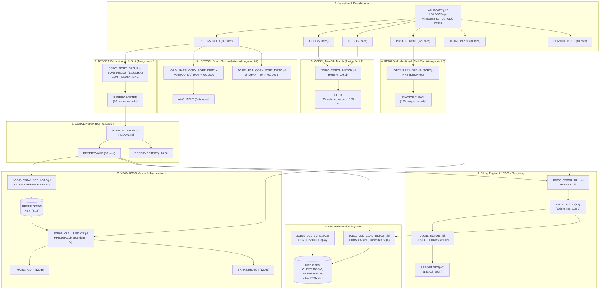

# HRBS - System Architecture, Data Flow & Technical Specification

**Hotel Reservation and Billing System (HRBS)**  
Course: Mainframe Technology (ID3002) (PEC-I) | AY 2026-27 Sem-1  
Department of Computer Engineering, Vishwakarma Institute of Technology (VIT), Pune  

---

## 1. End-to-End Batch Data Flow Architecture

The HRBS batch pipeline processes hospitality bookings from raw sequential input through deduplication, validation, VSAM indexing, billing calculations, 132-column reporting, and relational DB2 storage:

---

## 2. Program & Component Catalog

| Member Name | Language | JCL Job | Purpose | Input Datasets | Output Datasets | Target RC |
|---|---|---|---|---|---|---|
| **`HRBSMTCH`** | Enterprise COBOL | `JOB02` | Matches reservations with payments via in-memory lookup table | `FILE1`, `FILE2` (80 B) | `FILE3` (160 B) | CC 0000 |
| **`HRBSDEDP`** | TSO/E REXX | `JOB03` | Deduplicates and sorts invoices using associative stems and shell sort | `INVOICE.INPUT` (100 B) | `INVOICE.CLEAN` (100 B) | CC 0000 |
| **`HRBSVAL`** | Enterprise COBOL | `JOB07` | Validates reservations across 10 business rules | `RESERV.SORTED` (80 B) | `RESERV.VALID` (80 B), `RESERV.REJECT` (120 B) | CC 0000 / 0004 |
| **`HRBSUPD`** | Enterprise COBOL | `JOB09` | Random update of VSAM KSDS (ADD/CANCEL/CHKOUT/UPDATE) | `RESERV.KSDS`, `TRANS.INPUT` | `RESERV.KSDS`, `TRANS.AUDIT`, `TRANS.REJECT` | CC 0000 / 0004 |
| **`HRBSBIL`** | Enterprise COBOL | `JOB06` | Computes room nights, 5% svc, extra services, tiered GST, total | `RESERV.VALID` (80 B), `SERVICE.INPUT` (80 B) | `INVOICE.OUTPUT` / `INVOICE.GDG(+1)` (100 B) | CC 0000 |
| **`HRBSRPT`** | Enterprise COBOL | `JOB11` | Generates 132-column billing report with control breaks by room type | Sorted Invoices (100 B) | `BILLING.REPORT` / `REPORT.GDG(+1)` (132 B) | CC 0000 |
| **`HRBSDB2`** | COBOL + SQL | `JOB12` | Batch loads reservations and bills into DB2; runs unpaid cursor query | `RESERV.VALID`, `INVOICE.OUTPUT` | DB2 Tables (`RESERVATION`, `BILL`) | CC 0000 |
| **`HRBSUTIL`** | TSO/E REXX | N/A (CLI) | Interactive utility for COUNT, CHKDUP, and FIND operations | Any PS/PDS | Terminal Display / Spool | RC 0 / 4 / 8 |

---

## 3. Dataset & Record Layout Specifications

### A. Reservation Record (`RESERV`, `FILE1`, `VALID`) — LRECL = 80, RECFM = FB
| Offset | Length | Field Name | Type | Description |
|---|---|---|---|---|
| 0 | 3 | `RV-TYPE` | CHAR(3) | Literal `'RSV'` |
| 3 | 3 | `RV-HOTEL` | CHAR(3) | Hotel Branch Code (`'PUN'`) |
| 6 | 6 | `RV-BKDATE` | CHAR(6) | Booking Date (`YYMMDD`) |
| **12** | **8** | **`RV-ID`** | **CHAR(8)** | **Primary Key** (`'RSxxxxxx'`) |
| 20 | 20 | `RV-NAME` | CHAR(20) | Guest Name (padded) |
| 40 | 4 | `RV-ROOM` | CHAR(4) | Assigned Room Number (`0101`-`0520`) |
| 44 | 4 | `RV-RTYPE` | CHAR(4) | Room Category (`'STD '`, `'DLX '`, `'STE '`) |
| 48 | 8 | `RV-CHKIN` | NUM(8) | Check-in Date (`YYYYMMDD`) |
| 56 | 8 | `RV-CHKOUT` | NUM(8) | Check-out Date (`YYYYMMDD`) |
| 64 | 2 | `RV-GUESTS` | NUM(2) | Number of Occupants (`01`-`04`) |
| 66 | 6 | `RV-RATE` | NUM(6) | Rate per night in INR (`003500`, `005200`, `008800`) |
| 72 | 1 | `RV-STATUS` | CHAR(1) | Booking Status: `'C'` (Confirmed), `'X'` (Cancelled), `'O'` (Checked-out) |
| 73 | 7 | `FILLER` | CHAR(7) | Trailing spaces |

### B. Transaction Record (`TRANS.INPUT`) — LRECL = 80, RECFM = FB
| Offset | Length | Field Name | Type | Description |
|---|---|---|---|---|
| 0 | 3 | `TR-TYPE` | CHAR(3) | Literal `'TRN'` |
| 3 | 1 | `TR-ACTION` | CHAR(1) | Action Code: `'A'` (Add), `'C'` (Cancel), `'O'` (Check-out), `'U'` (Update) |
| 4 | 8 | `TR-ID` | CHAR(8) | Reservation ID (`'RSxxxxxx'`) |
| 12 | 20 | `TR-NAME` | CHAR(20) | Guest Name |
| 32 | 4 | `TR-ROOM` | CHAR(4) | Room Number |
| 36 | 4 | `TR-RTYPE` | CHAR(4) | Room Category (`'STD '`, `'DLX '`, `'STE '`) |
| 40 | 8 | `TR-CHKIN` | NUM(8) | Check-in Date (`YYYYMMDD`) |
| 48 | 8 | `TR-CHKOUT` | NUM(8) | Check-out Date (`YYYYMMDD`) |
| 56 | 2 | `TR-GUESTS` | NUM(2) | Guest count |
| 58 | 6 | `TR-RATE` | NUM(6) | Nightly Rate |
| 64 | 1 | `TR-STATUS` | CHAR(1) | New Status |
| 65 | 15 | `TR-FILLER` | CHAR(15) | Booking Date / Hotel branch / Spaces |

### C. Extra Services Record (`SERVICE.INPUT`) — LRECL = 80, RECFM = FB
| Offset | Length | Field Name | Type | Description |
|---|---|---|---|---|
| 0 | 8 | `SRV-RES-ID` | CHAR(8) | Reservation ID (`'RSxxxxxx'`) |
| 8 | 1 | `FILLER` | CHAR(1) | Space delimiter |
| 9 | 4 | `SRV-CODE` | CHAR(4) | Service Category: `'LAUN'`, `'DINR'`, `'SPA '`, `'MINB'`, `'CAB '` |
| 13 | 1 | `FILLER` | CHAR(1) | Space delimiter |
| 14 | 8 | `SRV-AMOUNT` | NUM(8) | Charge in zoned decimal (`9(6)V99`) |
| 22 | 58 | `FILLER` | CHAR(58) | Description and trailing spaces |

### D. Validation / Transaction Reject Record (`REJECT`) — LRECL = 120, RECFM = FB
| Offset | Length | Field Name | Type | Description |
|---|---|---|---|---|
| 0 | 80 | `RJ-ORIG-REC` | CHAR(80) | Original raw record that triggered rejection |
| 80 | 2 | `RJ-CODE` | CHAR(2) | Two-digit rejection reason code (`01`-`10`, `22`, `23`, `RO`, `99`) |
| 82 | 38 | `RJ-MESSAGE` | CHAR(38) | Descriptive human-readable rejection explanation |

### E. Formatted Invoice Record (`INVOICE`, `INVOICE.CLEAN`) — LRECL = 100, RECFM = FB
| Offset | Length | Field Name | Type | Description |
|---|---|---|---|---|
| 0 | 3 | `INV-TYPE` | CHAR(3) | Literal `'INV'` |
| 3 | 3 | `INV-HOTEL` | CHAR(3) | Hotel Branch Code (`'PUN'`) |
| 6 | 8 | `INV-DATE` | CHAR(8) | Invoice Date (`YYYYMMDD`) |
| 14 | 10 | `INV-GUEST` | CHAR(10) | Formatted Guest ID (`'G'` + 9 digits) |
| **24** | **8** | **`INV-ID`** | **CHAR(8)** | **Invoice Primary Key** (`'IN'` + 6 digits) |
| 32 | 8 | `INV-RES` | CHAR(8) | Reservation ID (`'RSxxxxxx'`) |
| 40 | 20 | `INV-NAME` | CHAR(20) | Guest Name |
| 60 | 3 | `INV-NIGHTS` | NUM(3) | Billed room nights |
| 63 | 8 | `INV-ROOM` | NUM(8) | Room charges (`9(6)V99`) |
| 71 | 8 | `INV-SVC` | NUM(8) | Service charges (`5%` base + extra services) |
| 79 | 8 | `INV-TAX` | NUM(8) | GST Tax (`5%` if rate $\le$ 7500, else `18%`) |
| 87 | 10 | `INV-TOT` | NUM(10) | Total Billed Amount (`9(8)V99`) |
| 97 | 1 | `INV-STATUS` | CHAR(1) | Payment Status (`'P'` = Paid, `'U'` = Unpaid) |
| 98 | 2 | `FILLER` | CHAR(2) | Trailing spaces |

---

## 4. Subsystem Return Code & Control Policy

To guarantee automated restartability and batch resilience:
- **`RC = 0000` (Success):** All records satisfied validation rules; operations committed.
- **`RC = 0004` (Warning):** Non-fatal events handled (e.g. invalid records diverted to `REJECT`, transaction duplicate keys audited, optional service file omitted). Subsequent jobs proceed.
- **`RC = 0008` (Error):** Reconciliation mismatch (e.g. ICETOOL count audit failure) or missing dataset. Batch halts dependent steps via `COND=(4,LT)`.
- **`RC = 0012+` (Severe/Abort):** File system error, DB2 SQL failure, or VSAM cluster open error. Immediate rollback issued and execution aborted.
